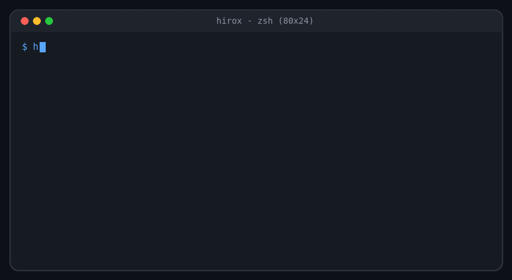

# Hirox

> Python-based multi-gateway AI agent foundation with an interactive terminal TUI, 44+ OpenAI-compatible & OAuth providers, local agentic tools, persistent memory with secret redaction, and built-in diagnostics.

[](LICENSE)
[](https://www.python.org/downloads/)
[](SECURITY.md)
[](CONTRIBUTING.md)

<p align="center">
  
</p>

---

## Table of Contents

- [Why Hirox](#why-hirox)
- [Key Features](#key-features)
- [Architecture](#architecture)
- [Quick Start](#quick-start)
- [CLI Reference](#cli-reference)
- [Supported Providers (44+)](#supported-providers-44)
- [Gateways](#gateways)
- [Agentic Tools & Permission Modes](#agentic-tools--permission-modes)
- [Memory & Session Persistence](#memory--session-persistence)
- [Security](#security)
- [Project Structure](#project-structure)
- [Development & Testing](#development--testing)
- [Contributing](#contributing)
- [License](#license)

---

## Why Hirox

Most AI agent frameworks lock you into a single provider SDK or a single chat interface. **Hirox** provides a lightweight, dependency-minimal Python foundation (`click` + `rich` + standard library) that unifies:

- **One runtime, many gateways**: Serve the same agent across CLI, HTTP Webhook, Telegram, Discord, Slack, WhatsApp, and Matrix.
- **One catalog, 44+ providers**: Switch seamlessly between cloud APIs, PKCE OAuth flows, and local inference servers (Ollama, LM Studio, vLLM, Jan, LocalAI).
- **Safe local execution**: Built-in permission modes (`read_only`, `ask`, `full_access`) and automatic secret redaction before writing to persistent memory.

---

## Key Features

- **Interactive Chat TUI (`hirox chat`)**: Rich terminal interface with slash commands, session history, live tool execution, and provider/model switching.
- **Interactive Config TUI (`hirox config`)**: Browse and configure providers, models, API keys, OAuth logins, and gateways without hand-editing JSON.
- **PKCE OAuth 2.0 Support**: Built-in local callback server and token refresh for `openai_codex_oauth`, `antigravity_oauth`, `gemini_oauth`, and `grok_oauth`.
- **Multi-Gateway Runtime (`hirox start`)**: Coordinates gateway lifecycles, health snapshots, and connected client tracking.
- **Environment Diagnostics (`hirox doctor`)**: Checks Python version, config validity, provider readiness, and gateway status (supports `--json` for automation).
- **Persistent Memory & Sessions**: Stores long-term context in `~/.hirox/` with automatic redaction of API keys, private keys, and tokens.

---

## Architecture

```text
                  +-----------------------------------+
                  |         Gateways (7)              |
                  | CLI | Webhook | Telegram | Discord|
                  | Slack | WhatsApp | Matrix         |
                  +-----------------+-----------------+
                                    |
                                    v
                  +-----------------------------------+
                  |          HiroxRuntime             |
                  |  - GatewayRegistry & Health       |
                  |  - Dynamic System Prompt Builder  |
                  |  - Session & Memory Persistence   |
                  +--------+-----------------+--------+
                           |                 |
                           v                 v
        +------------------------+   +------------------------+
        |   Provider Catalog     |   |   Agentic Tool Engine  |
        |  - 44+ OpenAI-Compat   |   |  - read_only / ask /   |
        |  - PKCE OAuth 2.0      |   |    full_access modes   |
        |  - Local (Ollama/vLLM) |   |  - list/read/write/sh  |
        +------------------------+   +------------------------+
```

---

## Quick Start

**Prerequisites**: Python 3.11 or higher.

### 1. Clone and Install

```bash
git clone https://github.com/ironskell0/hirox.git
cd hirox
pip install -e .
```

### 2. Initialize Configuration & Run Diagnostics

```bash
hirox config init
hirox doctor
```

### 3. Configure a Provider

Set an API key via environment variable or launch the interactive Config TUI:

```bash
export OPENAI_API_KEY="your-api-key"
# or open the interactive Config TUI:
hirox config
```

### 4. Start Chatting or Run Gateways

```bash
# Launch interactive terminal chat
hirox chat

# Or start the multi-gateway runtime (dry-run first to inspect)
hirox start --dry-run
hirox start
```

---

## CLI Reference

| Command | Description | Key Options |
| --- | --- | --- |
| `hirox start` | Start the Hirox agent runtime and enabled gateways | `-g, --gateway`, `--port`, `--dry-run` |
| `hirox chat` | Start an interactive chat session | `-g, --gateway`, `--tui / --no-tui` |
| `hirox config` | Open the interactive Config TUI (default) | Subcommands: `tui`, `init`, `show`, `get`, `set`, `path` |
| `hirox doctor` | Run environment, config, and gateway diagnostics | `--json` |

### Config Subcommands

```bash
hirox config path                  # Print active config file path (~/.hirox/config.json)
hirox config init [--force]        # Create default configuration
hirox config show                  # Print effective JSON configuration
hirox config get runtime.port      # Read a dotted config key
hirox config set runtime.port 9000 # Update a dotted config key
```

---

## Supported Providers (44+)

Hirox includes a built-in catalog of OpenAI-compatible, OAuth, and local providers:

| Category | Providers |
| --- | --- |
| **Major Cloud** | OpenAI, Anthropic (Compat), Google Gemini, xAI (Grok), Mistral AI, Cohere (Compat), Perplexity |
| **OAuth 2.0 (PKCE)** | OpenAI Codex OAuth, Gemini OAuth, Antigravity OAuth, Grok Bot OAuth |
| **Inference & Routers** | OpenRouter, Groq, DeepSeek, Together AI, Fireworks AI, Cerebras, SambaNova, DeepInfra, Hugging Face, NVIDIA NIM, GitHub Models, Azure OpenAI, Cloudflare Workers AI, Replicate, Novita AI, Hyperbolic, Nebius, Featherless, Chutes, Venice, SiliconFlow, Poe |
| **Asia-Pacific Models** | Moonshot AI (Kimi), Zhipu AI (GLM), Alibaba Qwen (DashScope), 01.AI (Yi), MiniMax, StepFun |
| **Local Runtimes** | Ollama, LM Studio, vLLM, Jan, LocalAI |

---

## Gateways

Hirox routes messages from multiple channels into `HiroxRuntime`:

- **CLI** (`cli`): Interactive terminal chat and plain-text fallback.
- **Webhook** (`webhook`): Built-in HTTP server (`ThreadingHTTPServer`) with live health snapshot and client tracking.
- **Messaging Platforms**: Telegram, Discord, Slack, WhatsApp, and Matrix adapters managed through `GatewayRegistry`.

---

## Agentic Tools & Permission Modes

Hirox exposes local workspace tools (`list_dir`, `read_file`, `write_file`, `run_command`, and more) governed by three explicit permission modes:

| Mode | Behavior |
| --- | --- |
| `read_only` | Browse directories and read files only; no writes or shell execution. |
| `ask` | Read freely; prompts for confirmation before writing files or running commands. |
| `full_access` | Unrestricted command and file execution (use with caution). |

---

## Memory & Session Persistence

- **Home Directory**: Stored under `~/.hirox/` (override with `HIROX_HOME`).
- **Sessions**: Saved in `~/.hirox/sessions/` with automatic session titles and message history.
- **Memory**: Persistent `MEMORY.md`-style context injected into the dynamic system prompt alongside live runtime metadata (OS, architecture, working directory, permission mode).
- **Secret Redaction**: Before persisting `<memory_write>` entries, Hirox automatically redacts private keys (`-----BEGIN ... PRIVATE KEY-----`), SSH keys, API tokens (`sk-...`, `AIza...`, `ghp_...`, `xox...`), and `password=` / `api_key=` assignments.

---

## Security

Security is a first-class priority in Hirox. Please read [SECURITY.md](SECURITY.md) for:

- Private vulnerability reporting via GitHub Security Advisories
- Credential and OAuth token storage guidelines
- Built-in memory secret redaction details
- Safe gateway binding practices

---

## Project Structure

```text
hirox/
├── assets/
│   └── hirox-demo.gif       # Animated CLI & TUI demo
├── src/hirox/
│   ├── __init__.py          # Package metadata & version
│   ├── __main__.py          # `python -m hirox` entrypoint
│   ├── cli.py               # Click CLI commands (start, chat, config, doctor)
│   ├── config.py            # Config loading, saving, dotted key access
│   ├── config_tui.py        # Interactive configuration TUI
│   ├── doctor.py            # Environment & gateway diagnostics
│   ├── gateway.py           # Multi-gateway implementations & registry
│   ├── i18n.py              # Localization helpers
│   ├── memory.py            # Persistent memory & secret redaction
│   ├── oauth.py             # PKCE OAuth 2.0 flow & token refresh
│   ├── providers.py         # 44+ provider catalog & chat client
│   ├── runtime.py           # Core HiroxRuntime coordinator
│   ├── sessions.py          # Persistent chat session management
│   ├── tools.py             # Agentic tools & permission enforcement
│   └── tui.py               # Interactive chat TUI
├── tests/
│   └── test_cli.py          # CLI, config, provider, memory & tool tests
├── CONTRIBUTING.md
├── LICENSE
├── pyproject.toml
├── README.md
└── SECURITY.md
```

---

## Development & Testing

```bash
pip install -e .
pip install pytest
pytest -q
```

---

## Contributing

Contributions are welcome! Please read [CONTRIBUTING.md](CONTRIBUTING.md) before opening a Pull Request.

---

## License

MIT © [ironskell0](https://github.com/ironskell0) — see [LICENSE](LICENSE) for details.
